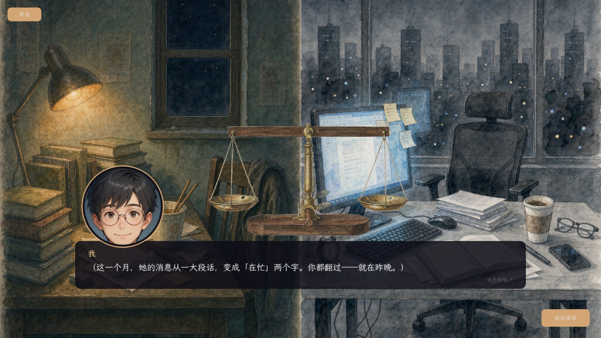
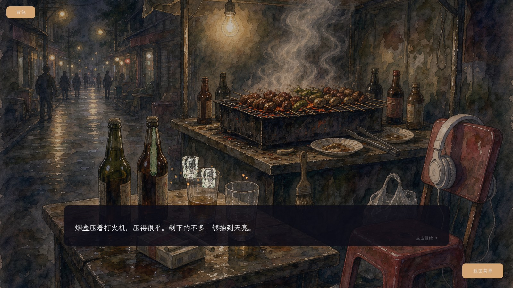

# 开始懂了 · 试玩版下载

> 一个关于"分手之后"的 2D 半开放叙事游戏。
> 16 章总案，已实装 14 章；点哪儿都有回应，微信、台球、夜摊、骑行都是真能玩的东西。

**[⬇ 直接下载（zip，约 310 MB）](https://github.com/anglelove3/fangguoge-demo/releases/latest/download/fangguoge-demo-win64.zip)**

Windows 10/11 64 位 · 解压即玩，无需安装 · 无需 Godot

<b>第一次运行被 Windows 拦住了？点这里（30 秒解决）</b>

这个 exe 没有买代码签名证书，Windows 首次运行会弹蓝色窗口「Windows 已保护你的电脑」：

1. 点窗口里的 **「更多信息」**
2. 点右下角 **「仍要运行」**

杀软误报同理，添加信任即可。程序不会联网上传任何东西，存档只在 `%APPDATA%\Godot\app_userdata\` 下。

---

## 这是个什么游戏

主角"放过哥"和女友异地、读研、投简历、写论文，最后分手。
游戏不给你选择题的正确答案——它只是把那些说不出口的时刻摆在桌上，让你自己碰一下：

- **能点的地方都有回应**：窗台的打火机、桌上的烟灰缸、烤炉上的白烟、空着的塑料凳……每处一句心里话。
- **手机是真的能用**：微信里能翻聊天记录、看朋友圈、删好友、置顶联系人。
- **小游戏不是摆设**：台球要真的对杆（还能认输）、骑行要真的控方向、倒酒会一杯一杯涨。
- **选择会记账**：好感、勇气、隐藏物品、你说过的每句话。

## 操作

| 操作 | 说明 |
|---|---|
| 鼠标左键 | 推进对话 / 点击场景里的东西 |
| Tab | 切换自动播放 |
| Esc | 关掉当前界面（手机、背包、台球） |
| 拖动 | 台球：拉杆力度；天平章：拖东西上托盘 |
| 设置 → 开发者选项 | 章节直达（想直接看后面某章可以用） |
| F3 | 帧耗时叠层（可选） |
| F12 | 开发者信息面板（可选） |

## 已实装章节

序章 · 寄居蟹 · 一千公里 · 天平 · 星月 · 晚安 · 手滑 · 碧蓝蓝天 · 放过自己 · 三点水 · 还想再见 · 置顶 · 十里长亭 · 爱就梭哈

## 更新日志（最近三次）

- **v1.5.0（2026-10-19）**：第十四章《爱就梭哈》上线——她第一次来他的学校，校门 / 校园三处闲笔 / 小馆 /
  实验楼下的"你的心跳得好快"三个回答。修了章末卡章号对不上、切章卡顿（后台预载 + 黑屏盖住首帧）、结局页章号错位 32 处。
- **v1.4.0（2026-10-18）**：台球可认输、胜负给勇气；修复第四/五章无法返回主菜单；
  返回按钮在任何界面都能点；骑行重画（骑手/路肩四层景）；全部 14 章补齐"点万物有回应"；混音重新配比；夜市人声底噪。
- **v1.3.0（2026-10-18）**：整体审计 + 手机壁纸三态 + 卡牌/台球/八球规则修整。

完整记录见 [CHANGELOG.md](CHANGELOG.md)。

## 技术

- 引擎：**Godot 4.7.2（Mono / C#）**
- 美术：水彩风 AI 生成 + 手工修图；界面全部代码绘制
- 音乐：Erik Satie《Gymnopédie》公有领域录音、Kevin MacLeod（CC-BY 4.0）

## 说明

- 本项目为**个人作品集 / 非商业 Demo**，素材仅用于展示，不作商用。
- 试玩版会包含未完成内容与调试入口，正式版会清理。
- 源码仓库：[anglelove3/fangguoge-game](https://github.com/anglelove3/fangguoge-game)
